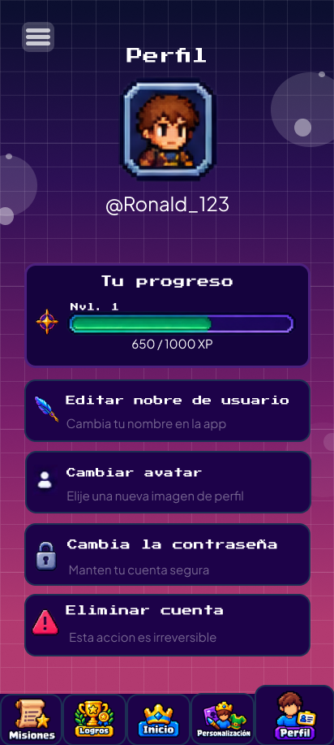
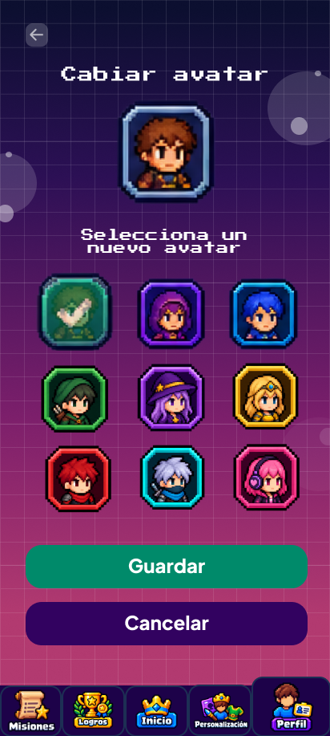
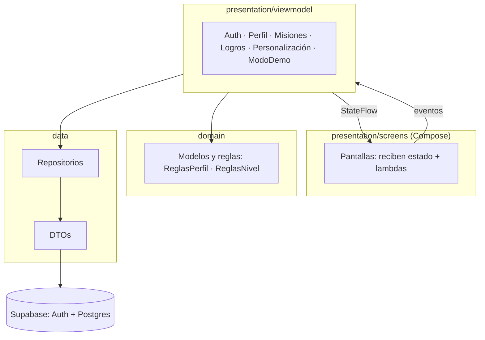

# Levelia

[](https://github.com/JUSHEP/levelia/actions/workflows/build-apk.yml)

App Android que convierte los hábitos en un juego de rol pixel-art. El usuario acepta **misiones** (ir al
gym, ir a clases, estudiar…), registra su progreso cada día, gana **XP**, **sube de nivel**, desbloquea
**logros** y gasta **esmeraldas** en **skins** para su personaje.

<p align="center">
  
  
</p>

---

## Contenido

1. [Funcionalidades](#funcionalidades)
2. [Tecnologías](#tecnologías)
3. [Arquitectura](#arquitectura)
4. [Estructura del proyecto](#estructura-del-proyecto)
5. [Base de datos (Supabase)](#base-de-datos-supabase)
6. [Cómo ejecutar el proyecto](#cómo-ejecutar-el-proyecto)
7. [Pruebas](#pruebas)
8. [Flujo de trabajo con git](#flujo-de-trabajo-con-git)
9. [Documentación](#documentación)

---

## Funcionalidades

| Módulo | Qué incluye | Estado |
|---|---|---|
| **1. Autenticación** | Registro con código de 6 dígitos por correo, login, "Recordarme", recuperar contraseña con código | ✅ Terminado y probado |
| **2. Perfil** | Ver nivel y XP, cambiar nombre y avatar, cambiar contraseña, eliminar cuenta | ✅ Terminado y probado |
| **3. Misiones** | Misiones predefinidas y propias, ajustar dificultad, aceptar, registrar progreso (1 vez al día), reclamar XP y subir de nivel | ✅ Terminado y probado |
| **4. Logros** | Medallas que se desbloquean solas, detalle de cada logro y aviso "¡Logro desbloqueado!" | ✅ Terminado (medallas provisionales) |
| **5. Personalización e Inicio** | Esmeraldas, skins por nivel y tienda de skins, Inicio con el personaje equipado | 🟡 Falta revisarlo en el emulador |
| **Modo demo** | Botones para avanzar días o subir de nivel y mostrar la app sin esperar | 🟡 Falta revisarlo en el celular |
| **Sin conexión** | Pantalla que tapa la app mientras el teléfono no tiene internet | ✅ Terminado |

**Niveles:** van del 1 al 100. Para pasar del nivel *n* al *n + 1* hacen falta `100 + 10 · (n − 1)` XP.

---

## Tecnologías

| Pieza | Versión | Para qué |
|---|---|---|
| Kotlin | 2.0.21 | Lenguaje |
| Jetpack Compose + Material 3 | BOM 2024.09.00 | Interfaz (sin XML) |
| Navigation Compose | 2.9.0 | Navegación entre pantallas |
| Hilt | 2.52 | Inyección de dependencias |
| Coroutines + StateFlow | — | Estado reactivo y llamadas en segundo plano |
| supabase-kt (auth + postgrest) | 3.0.2 | Cuentas, código por correo y base de datos |
| Ktor (OkHttp) | 3.0.1 | Cliente HTTP que usa Supabase |
| kotlinx-serialization | 1.7.3 | Convertir JSON ↔ clases Kotlin |
| Timber | 5.0.1 | Logs |
| JUnit 4 · MockK · coroutines-test | 4.13.2 · 1.13.13 · 1.9.0 | Pruebas unitarias |
| Android | minSdk 26 · targetSdk/compileSdk 36 | — |
| Build | AGP 8.13.2 · JDK 17–21 | — |

> **¿Por qué supabase-kt 3.0.2 y no la última?** Es la última compatible con Kotlin 2.0.21. Las versiones
> nuevas piden Kotlin 2.3 y obligarían a actualizar todo el proyecto.

---

## Arquitectura

**MVVM + repositorio**, con flujo de datos unidireccional (UDF): el estado baja del ViewModel a la pantalla
y los eventos suben de la pantalla al ViewModel.



| Capa | Carpeta | Responsabilidad |
|---|---|---|
| **UI** | `presentation/screens/` | Dibujar. Cada pantalla recibe estado + lambdas, nunca un ViewModel |
| **ViewModel** | `presentation/viewmodel/` | Guardar el estado (`StateFlow`), validar formularios y llamar al repositorio |
| **Dominio** | `domain/` | Modelos y reglas sin dependencias de Android (se prueban sin emulador) |
| **Datos** | `data/` | Hablar con Supabase, convertir JSON y traducir los errores al español |

**Decisiones principales:**

- **ViewModels compartidos:** se crean una sola vez en `MainActivity` y se pasan al `NavGraph`, para que
  el estado no se pierda al cambiar de pantalla.
- **La navegación sigue al estado:** al iniciar o cerrar sesión, el `NavGraph` observa `isAuthenticated`
  y lleva a Inicio o al Login vaciando el historial.
- **Repositorios sin excepciones:** toda función devuelve `AuthResult` (`Success` o `Error` con un mensaje
  en español). El ViewModel nunca recibe una excepción.
- **Las reglas importantes viven en el servidor:** la app solo lee las tablas. Todo lo que cambia XP,
  niveles o esmeraldas pasa por funciones SQL, así nadie puede darse XP desde una app modificada.

---

## Estructura del proyecto

```
app/src/main/java/com/levelia/levelia/
├── MainActivity.kt          ← crea los ViewModels compartidos y el NavGraph
├── LeveliaApplication.kt    ← @HiltAndroidApp y Timber
├── di/                      ← SupabaseModule: un único cliente de Supabase
├── data/
│   ├── remote/              ← SupabaseConfig y DTOs
│   └── repository/          ← Auth, Misiones, Logros, Personalizacion y ModoDemo; Errores.kt
├── domain/
│   ├── ReglasPerfil.kt, ReglasNivel.kt
│   └── models/              ← estados de pantalla, rutas (Destinations) y modelos
├── presentation/
│   ├── navigation/          ← NavGraph.kt
│   ├── viewmodel/           ← un ViewModel por módulo
│   └── screens/             ← pantallas Compose
│       └── components/      ← LeveliaUi (sistema de diseño), PerfilUi, MisionesUi, BarraInferior…
└── ui/theme/                ← colores, tipografías y tema

app/src/main/res/drawable-nodpi/   ← pixel-art
app/src/test/                      ← pruebas unitarias
supabase/                          ← scripts SQL (esquema, funciones y pruebas)
docs/                              ← documentación y referencias de Figma
.github/workflows/build-apk.yml    ← compila el APK en cada push
```

---

## Base de datos (Supabase)

Todas las tablas tienen **RLS** (seguridad por filas): cada usuario solo ve lo suyo. La app usa la **clave
pública** (anon/publishable); nunca la `service_role`.

**Instalar o actualizar la base** (Supabase → SQL Editor, cada archivo completo y en este orden):

1. `supabase/setup.sql` — perfiles, progreso y seguridad
2. `supabase/misiones.sql` — módulo Misiones
3. `supabase/logros.sql` — módulo Logros
4. `supabase/personalizacion.sql` — esmeraldas y skins
5. `supabase/modo_demo.sql` — modo demo

Todos se pueden volver a ejecutar sin perder datos.

**Configuración del panel de Supabase** (no está en el código):

- Authentication → Email Templates → "Confirm signup" y "Reset password": el texto debe incluir
  `{{ .Token }}` para que el correo traiga el código de 6 dígitos.
- Authentication → Sign In / Providers → Email: "Confirm email" activo y Password Requirements en
  "Lowercase, uppercase letters and digits", con mínimo 8 caracteres (igual que la app).
- SMTP propio (el de Supabase solo envía unos pocos correos por hora).

**Conectar la app:** pega la Project URL y la clave pública en
`app/src/main/java/com/levelia/levelia/data/remote/SupabaseConfig.kt`.

El detalle de tablas y funciones está en [`docs/DOCUMENTACION_LEVELIA.md`](docs/DOCUMENTACION_LEVELIA.md#5-base-de-datos-supabase).

---

## Cómo ejecutar el proyecto

**Requisitos:** JDK 17–21 y el SDK de Android (o Android Studio). Gradle 8.13 no funciona con Java 25.

```bash
git clone https://github.com/JUSHEP/levelia.git
cd levelia
```

| Acción | Windows (PowerShell) | Linux (bash) |
|---|---|---|
| Compilar el APK | `.\gradlew.bat assembleDebug` | `./gradlew assembleDebug` |
| Instalar en el emulador o celular | `.\gradlew.bat installDebug` | `./gradlew installDebug` |
| Pruebas unitarias | `.\gradlew.bat testDebugUnitTest` | `./gradlew testDebugUnitTest` |

- El APK queda en `app/build/outputs/apk/debug/app-debug.apk`.
- En Windows, si Gradle usa un Java no compatible:
  `$env:JAVA_HOME = "C:\Program Files\Java\jdk-21.0.12.1"` (ajusta la ruta a tu JDK).
- En Linux, si `./gradlew` falla con `sh\r`: `sed -i 's/\r$//' gradlew`.

**Sin instalar nada:** cada push compila el APK en GitHub Actions. Ve a **Actions** → la ejecución más
reciente → **Artifacts** → **levelia-apk**.

---

## Pruebas

| Tipo | Dónde |
|---|---|
| Unitarias: ViewModels con repositorio simulado (MockK), reglas, DTOs y errores | `app/src/test/` |
| Reglas y seguridad de la base (RLS y funciones) | `supabase/pruebas*.sql` |
| Visuales contra Figma en el emulador (Pixel 6, 412 dp) | [`REVISION_EMULADOR.md`](REVISION_EMULADOR.md) |

> `supabase/pruebas.sql` termina **a propósito** con un error que contiene `PRUEBAS_OK`, para revertir
> todo lo que creó. Cualquier mensaje `FALLO: ...` sí es un problema real.

---

## Flujo de trabajo con git

- Se trabaja en **ramas** y se une a `main` con un **pull request**.
- Mensajes de commit en español, cortos y claros.
- Antes del pull request, revisa que la compilación de GitHub Actions salga en verde.

---

## Documentación

| Archivo | Contenido |
|---|---|
| [`docs/DOCUMENTACION_LEVELIA.md`](docs/DOCUMENTACION_LEVELIA.md) | Documentación completa: módulos, flujos, base de datos y preguntas frecuentes |
| [`docs/CONTEXTO_LEVELIA.md`](docs/CONTEXTO_LEVELIA.md) | Branding (colores, medidas y textos exactos), flujo de usuario y problemas resueltos |
| [`docs/PROMPT_SUPABASE_LEVELIA.md`](docs/PROMPT_SUPABASE_LEVELIA.md) | Especificación del esquema de la base de datos |
| [`docs/QA_REPORTE.md`](docs/QA_REPORTE.md) | Pruebas realizadas y hallazgos |
| [`REVISION_EMULADOR.md`](REVISION_EMULADOR.md) | Cómo revisar las pantallas en el emulador y compararlas con Figma |
| [`CLAUDE.md`](CLAUDE.md) | Reglas para trabajar en el código |

<!--
## Equipo

Completar con los nombres de los integrantes, el curso y el profesor.
-->
