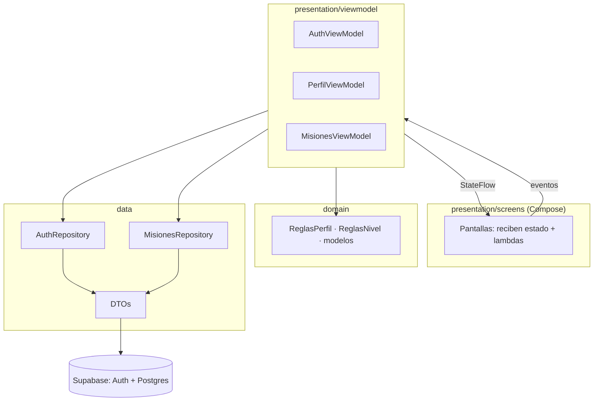
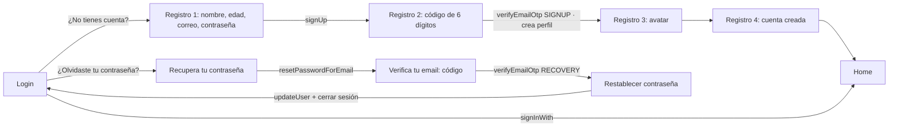
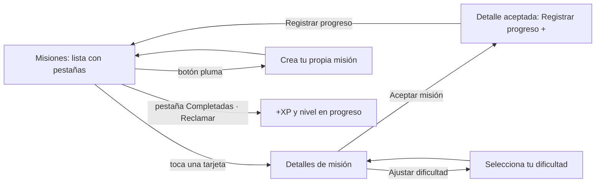

# Levelia — documentación del proyecto

> Estado al **2026-11-05**. Resume qué hace la app, cómo está construida, qué se probó y qué falta.
> Documentos relacionados: `CONTEXTO_LEVELIA.md` (branding y medidas exactas), `QA_REPORTE.md` (pruebas y
> hallazgos), `PROMPT_SUPABASE_LEVELIA.md` (especificación original de la base), `../CLAUDE.md` (reglas
> para trabajar en el código).

---

## 1. Qué es Levelia

Una app Android que convierte hábitos en un juego de rol pixel-art: el usuario acepta **misiones** (ir al
gym, ir a clases, estudiar…), registra su progreso, gana **XP** y **sube de nivel** (del 1 al 100).

| Módulo | Estado |
|---|---|
| 1. Autenticación (registro con código, login, recuperar contraseña) | ✅ Terminado y probado en el emulador |
| 2. Perfil (nombre, avatar, contraseña, eliminar cuenta, nivel/XP) | ✅ Terminado y probado en el emulador |
| 3. Misiones | ✅ Completo y probado de punta a punta (crear, ajustar, aceptar, progreso, reclamar, subir de nivel) |
| 4. Logros | ✅ Backend y pantallas (Logros, Detalles del logro, aviso de desbloqueo); medallas provisionales. Desde el 2026-11-05 dan esmeraldas |
| 5. Personalización (esmeraldas, skins por nivel y tienda) e Inicio | 🟡 Backend probado en Postgres local; la app compila y pasa las pruebas en GitHub Actions, falta revisarla en el emulador. Skins provisionales |
| Modo demo (para mostrar la app sin esperar días) | 🟡 Backend probado en Postgres local; app escrita, falta revisarla en el celular |

---

## 2. Tecnologías

| Pieza | Versión | Para qué |
|---|---|---|
| Kotlin | 2.0.21 | Lenguaje |
| Jetpack Compose (BOM) | 2024.09.00 | Interfaz (sin XML) |
| Material 3 | del BOM | Componentes base (la app usa sus propios componentes encima) |
| Navigation Compose | 2.9.0 | Navegación entre pantallas |
| Hilt | 2.52 | Inyección de dependencias |
| Coroutines + StateFlow | — | Estado reactivo y llamadas en segundo plano |
| supabase-kt (auth + postgrest) | **3.0.2** | Cuentas, código por correo y base de datos |
| Ktor | 3.0.1 | Cliente HTTP que usa Supabase |
| kotlinx-serialization | 1.7.3 | Convertir JSON ↔ clases Kotlin |
| Timber | 5.0.1 | Logs |
| JUnit 4 · MockK 1.13.13 · coroutines-test 1.9.0 | — | Pruebas unitarias |
| Android | minSdk 26 · target/compile 36 | — |
| Build | AGP 8.13.2, Gradle, JDK 17–21 | En este PC: JDK 21 (`C:\Program Files\Java\jdk-21.0.12.1`) |

> **¿Por qué supabase-kt 3.0.2 y no la última?** Es la última compatible con Kotlin 2.0.21. Las nuevas
> piden Kotlin 2.3 y obligarían a actualizar todo el proyecto. La documentación en línea es de versiones
> nuevas: los nombres de la API se confirmaron leyendo la librería 3.0.2 instalada.

---

## 3. Arquitectura

### 3.1 Capas (MVVM + repositorio)



| Capa | Carpeta | Responsabilidad | Regla clave |
|---|---|---|---|
| **UI** | `presentation/screens/` | Dibujar. Cada pantalla recibe **estado + lambdas**, nunca un ViewModel | Sin lógica de negocio |
| **ViewModel** | `presentation/viewmodel/` | Estado de pantalla (`StateFlow`), validaciones de formulario, llamar al repositorio | Nunca ve excepciones |
| **Dominio** | `domain/` | Modelos y reglas puras (sin Android): contraseña, nombre, correo, curva de niveles | Se prueba sin emulador |
| **Datos** | `data/` | Hablar con Supabase, convertir JSON, **traducir errores a español** | Todo devuelve `AuthResult` (Success/Error) |

### 3.2 Decisiones de arquitectura (y por qué)

1. **ViewModels compartidos.** `AuthViewModel`, `PerfilViewModel` y `MisionesViewModel` se crean **una
   sola vez** en `MainActivity` y se pasan al `NavGraph`. Si cada pantalla creara el suyo, el estado se
   perdería al navegar (por ejemplo, el correo entre "Recupera tu contraseña" y "Verifica tu email").
2. **La navegación sigue al estado.** El registro no navega por su cuenta: el `NavGraph` observa
   `registerState.pasoActual`. Igual con `isAuthenticated` (va a Home o al Login vaciando el historial).
3. **Repositorio sin excepciones.** Toda función devuelve `AuthResult`; los errores de red, de Auth y de
   Postgres se traducen a mensajes en español en un solo lugar (`AuthRepository.mensajeDeError`,
   `MisionesRepository.mensajeDeError`, `Errores.kt`).
4. **Las reglas importantes viven en el servidor.** La app **solo lee** las tablas; todo lo que cambia XP,
   progreso o niveles pasa por **funciones SQL** (`security definer`). Así nadie puede darse XP desde un
   cliente modificado. La app repite algunas reglas solo para avisar antes (y están probadas igual en
   ambos lados).
5. **Reglas duplicadas a propósito**, que se deben cambiar juntas:

   | Regla | En la app | En la base |
   |---|---|---|
   | Nombre (3–20, letras sin tildes, números, `_`) | `ReglasPerfil.nombreValido` | CHECK de `perfiles` |
   | Contraseña (≥ 8, mayúscula, minúscula, número) | `ReglasPerfil.requisitosContrasena` | Supabase → Password Requirements |
   | Curva de niveles | `ReglasNivel.xpParaSubir` | `xp_para_subir()` |
   | Veces/XP por dificultad | enum `Dificultad` | `datos_dificultad()` |

6. **Sin conexión.** `MainActivity` pone `SinConexionScreen` encima de todo mientras no haya internet.
7. **Dos sistemas de UI.** `LeveliaUi.kt` es el diseño nuevo (pixel-art). `AuthComponents.kt` es el viejo y
   todavía lo usan los pasos 2–4 del registro, "Verifica tu email" de recuperar contraseña y Home.

### 3.3 Estructura de carpetas

```
app/src/main/java/com/levelia/levelia/
├── MainActivity.kt, LeveliaApplication.kt   ← crea los 3 ViewModels y el NavGraph
├── di/SupabaseModule.kt                     ← un único cliente de Supabase (Hilt)
├── data/
│   ├── remote/   SupabaseConfig.kt, PerfilDtos.kt, MisionesDtos.kt
│   └── repository/ AuthRepository.kt, MisionesRepository.kt, Errores.kt
├── domain/
│   ├── ReglasPerfil.kt, ReglasNivel.kt
│   └── models/   Models.kt (registro, rutas), PerfilModels.kt, MisionesModels.kt
├── presentation/
│   ├── navigation/NavGraph.kt
│   ├── viewmodel/  AuthViewModel.kt, PerfilViewModel.kt, MisionesViewModel.kt
│   └── screens/    Login, Registro 1–4, Recuperar (3), Home, Perfil (5), Misiones, SinConexion
│       └── components/ LeveliaUi, PerfilUi, MisionesUi, BarraInferior, AuthComponents, Conexion
└── ui/theme/   Color.kt (colores medidos de Figma), Type.kt (fuentes), Theme.kt
app/src/main/res/drawable-nodpi/   ← pixel-art (se reemplaza por exportaciones de Figma con el MISMO nombre)
app/src/test/                      ← pruebas unitarias
supabase/                          ← SQL: setup.sql, misiones.sql y sus pruebas
docs/                              ← esta documentación, QA, contexto, capturas de Figma
```

---

## 4. Módulos y flujos

### 4.1 Autenticación



- **Código por correo (OTP):** registro y recuperación usan un código de 6 dígitos (plantillas de Supabase
  con `{{ .Token }}`), 3 intentos y reenvío cada 60 s.
- **Cuenta = perfil:** el perfil se crea apenas se verifica el código. Una cuenta sin perfil no entra
  (registro a medias); registrarse otra vez con el mismo correo y contraseña la retoma.
- **Recuperar contraseña:** verificar el código abre una sesión temporal; se cierra al guardar o al
  cancelar. Si la app se cierra a mitad, al abrirla no entra a Home (marca `recuperacion_pendiente`).
- **Errores exactos de contraseña:** el diálogo dice qué falta ("…debe tener una mayúscula y un número",
  "Las contraseñas no coinciden") o el motivo con que Supabase la rechazó.

### 4.2 Perfil

Perfil → Editar nombre (único, sin tildes) · Cambiar avatar (9) · Cambiar contraseña (pide la actual) ·
Eliminar cuenta (función `eliminar_mi_cuenta`, borra todo en cascada). Muestra nivel y barra de XP leídos
de la tabla `progreso`; la meta del nivel sale de la curva de niveles.

### 4.3 Misiones (módulo 3)

**Reglas acordadas con el equipo:**

| Dificultad | Veces | XP | Plazo |
|---|---|---|---|
| Fácil ("Suave" en el formulario) | 1 vez/semana | +75 | 7 días desde que se acepta |
| Media | 3 veces/semana | +150 | 7 días |
| Difícil | 5 veces/semana | +300 | 7 días |
| Única | 1 vez | +50 | Fecha límite que elige el usuario |

- Máximo **1 registro de progreso por día**. Se cumple al llegar a la meta (ej. 3/3).
- Si pasa el plazo sin cumplirse queda **perdida**. La Única se valida contra su fecha: registrar antes o
  ese día la cumple; después, se pierde.
- La XP se suma al pulsar **"¡Reclamar recompensa!"** (todas las cumplidas de una vez), no al cumplir.
- Una misión se puede repetir cuando terminó el plazo de la anterior y su XP ya se reclamó. La Única,
  una sola vez. (Esto evita ganar XP infinita repitiendo la misma misión el mismo día.)
- "Ajustar dificultad" → "Guardar cambios" guarda la dificultad **en la base sin aceptar** la misión
  (tabla `misiones_preferencias`) y vuelve a la lista con las nuevas veces y XP. Al aceptar se usa la
  guardada. No se puede ajustar una misión en curso ni una Única (necesita fecha).
- Predefinidas visibles para todos: las 4 del diseño y, desde `misiones.sql` versión 5, 24 más (6 físicas,
  6 de estudio, 6 sociales y 6 de otro tipo, con las veces y XP de su dificultad). Las creadas por un usuario
  solo las ve él.
- Pestañas: **Activas** = aceptadas y en curso (vacía hasta aceptar una) · **Completadas** = cumplidas,
  reclamadas o no (ahí sale "¡Reclamar recompensa!" si falta XP por sumar) · **Todas** = el catálogo
  completo, primero las que aún no están cumplidas.

**Flujo previsto (diseño del equipo):**



**Qué está hecho:**

| Parte | Archivo | Estado |
|---|---|---|
| Tablas, seguridad y funciones | `supabase/misiones.sql` | ✅ Aplicado en Supabase (migraciones `crear_modulo_misiones_v3` e `indice_misiones_usuario_mision_id`) |
| Pruebas del SQL | `supabase/pruebas_misiones.sql` | ✅ `PRUEBAS_OK` |
| Repositorio | `MisionesRepository.kt` | ✅ |
| ViewModel (lista, aceptar, registrar, reclamar, crear con validaciones) | `MisionesViewModel.kt` | ✅ 17 pruebas |
| Pantalla "Misiones" (pestañas, tarjetas, botón crear) | `MisionesScreen.kt`, `MisionesUi.kt` | ✅ Revisada en el emulador |
| Crea tu propia misión · Detalles de misión · Ajustes de misión | `CrearMisionScreen`, `DetallesMisionScreen`, `AjustarDificultadScreen` (equipo) | ✅ |
| Ajustes guardados sin aceptar | tabla `misiones_preferencias` + `ajustar_dificultad()` | ✅ Migración `ajustes_dificultad_preferencias_v4` |
| Tarjetas verdes de cumplidas, "¡Reclamar recompensa!" y aviso de nivel | `MisionesUi.kt`, `MisionesScreen.kt` | ✅ Probado: 2 misiones Fácil → +150 XP → nivel 2 (50/283) |

### 4.4 Logros (módulo 4)

Medallas en familias de 3 niveles (bronce, plata, oro) que **no dan XP: dan esmeraldas**, la moneda de la
app (bronce 50, plata 100, oro 200; columna `logros.esmeraldas`). Hasta la versión 5 de `logros.sql` daban
piezas de equipamiento (casco, pechera, espada, botas); las tablas `articulos` e `inventario` quedan sin uso.

| Logro | Requisitos | Esmeraldas |
|---|---|---|
| ¡Primeros pasos! | 1 misión cumplida | 50 |
| ¡Calentamiento! → ¡En forma! → ¡¡Unidad absoluta!! | 3 / 10 / 30 misiones físicas · racha 7 / 30 días · la anterior | 50 · 100 · 200 |
| Estudioso → ¡Pensador! → ¡¡Sabio!! | 3 / 10 / 30 misiones de estudio · racha 7 / 30 días · la anterior | 50 · 100 · 200 |
| Aprendiz → ¡Junior! → ¡¡Senior!! | Nivel 5 / 10 / 25 · la anterior | 50 · 100 · 200 |
| Constante → ¡Imparable! → ¡¡Centenario!! | 10 / 50 / 100 misiones · la anterior | 50 · 100 · 200 |
| En racha → ¡Disciplinado! → ¡¡Inquebrantable!! | Racha de 7 / 30 / 100 días · la anterior | 50 · 100 · 200 |
| Rompehielos → ¡Sociable! → ¡¡Alma de la fiesta!! | 3 / 10 / 30 misiones sociales · racha 7 / 30 días · la anterior | 50 · 100 · 200 |
| Organizado → ¡Productivo! → ¡¡Maestro del tiempo!! | 3 / 10 / 30 misiones de otro tipo · racha 7 / 30 días · la anterior | 50 · 100 · 200 |
| ¡¡Atleta!! → ¡¡Titán!! (después de ¡¡Unidad absoluta!!) | 60 / 100 misiones físicas · la anterior | 200 · 200 |
| ¡¡Erudito!! → ¡¡Genio!! (después de ¡¡Sabio!!) | 60 / 100 misiones de estudio · la anterior | 200 · 200 |
| ¡¡Veterano!! → ¡¡Maestro!! → ¡¡Leyenda viva!! (después de ¡¡Senior!!) | Nivel 50 / 75 / 100 · la anterior | 200 · 200 · 200 |

Los 10 primeros son los del diseño; los otros 19 llegaron con `logros.sql` versión 7 (2026-11-05) para tener
metas hasta el nivel 100. Los sociales y de otro tipo van en la familia "General": una familia nueva rompería
la lista en las versiones de la app ya instaladas.

- La categoría de una misión sale de su ícono (pesa = físico, cerebro = estudio, personas = social,
  portapapeles = otro tipo).
- Una misión cuenta al cumplirla. La racha es la mayor cantidad de días seguidos con "Aumentar progreso"
  (tabla `registros_progreso`).
- El servidor desbloquea solo (al registrar progreso, al reclamar XP y al abrir Logros) y guarda la fecha.
  `mis_logros()` trae para cada logro el avance de sus requisitos, el "Progreso general" y el "Avance para el
  siguiente nivel" (desde la versión 7, el logro que tiene a este como requisito).
- App: `LogrosRepository`, `LogrosViewModel` (`cargar`, `onFiltro`, `logro(id)`, `nuevos`, `cerrarNuevos`,
  `limpiar`) y textos en `LogrosModels.kt` ("Completar 10 misiones físicas", "11 - sep - 2026 - 19:15").
- Pantallas: `LogrosScreen` (pestañas Obtenidos / Todos, cuadrícula de 3) y `DetallesLogroScreen`
  (desbloqueado: fecha y "Completado"; bloqueado: candado, familia/nivel, "Progreso general" y "Avance para el
  siguiente nivel"). Componentes en `components/LogrosUi.kt`. `LogrosViewModel` se crea en `MainActivity`;
  NavGraph lo relee al iniciar sesión, al registrar progreso y al reclamar XP, y muestra "¡Logro desbloqueado!"
  encima de cualquier pantalla (textos provisionales, sin diseño).
- Imágenes provisionales recortadas de los mockups: `logro_<id>.png`, `ic_logro_bloqueado.png`,
  `ic_logro_calendario.png` (reemplazar con el mismo nombre). ¡¡Sabio!! usa una copia de ¡Pensador!; los recortes
  de medallas que en el mockup salían bloqueadas quedaron apagados. Las imágenes de artículos siguen pendientes.
  Las 19 medallas de la versión 7 son provisionales armadas con las del diseño (un símbolo nuevo en el marco de
  bronce, plata u oro, o una medalla recoloreada en amatista, diamante o rubí para las que van después del oro).

### 4.5 Personalización e Inicio (módulo 5)

Acordado con el equipo el 2026-11-05. Diseño en `docs/figma/personalizacion/` (la skin "Sabio" del diseño era
de ejemplo y no se usa).

- **Esmeraldas = la única moneda.** Se ganan con logros (50 / 100 / 200) y al reclamar misiones (Fácil 10,
  Media 20, Difícil 40, Única 10). El servidor las paga una sola vez por logro y por misión; lo ganado antes
  de instalar el módulo también se paga la primera vez.
- **Skins del guerrero por nivel** (se desbloquean solas): Novato (1, sin armadura), Escudero (5), Soldado (10),
  Caballero (25), Paladín (50) y Leyenda (100). Las bloqueadas se ven como en el diseño: candado en la
  cuadrícula y silueta con "????" en el detalle.
- **Tienda** (el bloque "¡PRÓXIMAMENTE!" del diseño): Arquero 200, Vikingo 300, Samurái 450, Mago de
  batalla 600, Ninja 800 y Caballero oscuro 1200. Se ven antes de comprarlas; al comprar quedan equipadas.
- **Habilidades:** solo texto que describe la skin (no cambian la XP).
- **Inicio** con el diseño nuevo: nombre de la skin equipada, "NVL. N", la skin grande, el usuario y "Tu
  progreso". El menú ☰ trae "Cerrar sesión" ("Login" en el diseño), "Perfil" y "Configuraciones" (apagada,
  sin pantalla todavía); en las cuentas demo, también "Modo demo". Inicio no tiene scroll: la skin ocupa todo
  el alto que dejan los demás elementos (antes se dibujaba al tamaño en píxeles del PNG y se veía diminuta).

| Parte | Archivo |
|---|---|
| Tablas, seguridad, funciones y catálogo de skins | `supabase/personalizacion.sql` (va después de `logros.sql` versión 6) |
| Pruebas del SQL | `supabase/pruebas_personalizacion.sql` (`PRUEBAS_OK`) |
| Repositorio y modelos | `PersonalizacionRepository.kt`, `PersonalizacionDtos.kt`, `PersonalizacionModels.kt` |
| ViewModel (cargar, equipar, comprar con confirmación, avisos de skins nuevas) | `PersonalizacionViewModel.kt` (compartido, se crea en `MainActivity`) |
| Pantallas | `PersonalizacionScreen`, `DetallesSkinScreen`, `HomeScreen`; componentes en `components/PersonalizacionUi.kt` |
| Dibujos provisionales | `skin_<id>.png` (12) e `ic_esmeralda.png` en `drawable-nodpi` (reemplazar con el mismo nombre) |

Textos propios (el diseño no los trae): botón "Equipar" / "Comprar por 💎 N", diálogos de compra, aviso
"¡Skin desbloqueada!", subtítulo de la tienda y el "+N esmeraldas" de los avisos de recompensa y de logro.

### 4.6 Modo demo

Para mostrar la app (por ejemplo al profesor) sin esperar días. Es lo que se suele hacer en desarrollo: un
menú oculto que solo aparece en cuentas marcadas como de prueba, y que el servidor rechaza para las demás.

- **Marcar una cuenta** (SQL Editor, cambiando el nombre de usuario):
  `insert into public.cuentas_demo (user_id) select id from public.perfiles where lower(nombre) = lower('NombreDeUsuario') on conflict do nothing;`
- En esa cuenta, el menú ☰ de Inicio muestra **"Modo demo"**, con:
  - **Avanzar 1 día:** corre un día hacia atrás las fechas de las misiones de la cuenta, que es lo mismo que si
    hubiera pasado un día: se puede volver a registrar progreso, vencen los plazos y las rachas siguen. No se
    cambia la fecha del celular ni de la base.
  - **Dejar listo para subir al nivel 5 / 10 / 25 / 50 / 100:** deja la cuenta un nivel antes, a 1 XP de subir.
    Al cumplir y reclamar cualquier misión sube de nivel y salen los avisos de logro y de skin, como de verdad.
  - **+1 nivel**, **+500 esmeraldas** (para la tienda) y **Reiniciar cuenta demo** (nivel 1, sin misiones,
    logros, skins ni esmeraldas, para repetir la demostración).
- Una cuenta normal no ve la opción y las funciones le responden `NO_ES_DEMO`. La app nunca escribe en
  `cuentas_demo`.

| Parte | Archivo |
|---|---|
| Tabla, funciones y seguridad | `supabase/modo_demo.sql` (va al final, después de `personalizacion.sql`) |
| Pruebas del SQL | `supabase/pruebas_modo_demo.sql` (`PRUEBAS_OK`) |
| App | `ModoDemoRepository.kt`, `ModoDemoDtos.kt`, `ModoDemoModels.kt`, `ModoDemoViewModel.kt` (compartido, en `MainActivity`), `ModoDemoScreen.kt` (sin diseño de Figma: usa los componentes de la app) |

### 4.7 Niveles y XP

Del nivel *n* al *n+1* hacen falta `100 + 10 · (n − 1)` XP: cada nivel pide 10 XP más que el anterior.
Cambiada el 2026-11-05: la curva anterior, `round(100 · n^1.5)`, pedía 3 950 120 XP para llegar al nivel 100
(unas 13 000 misiones difíciles), así que las skins de nivel 25, 50 y 100 eran imposibles.

| Llegar al nivel | XP total | Con unas 6 misiones por semana |
|---|---|---|
| 5 | 460 | menos de una semana |
| 10 | 1 260 | 1 o 2 semanas |
| 25 | 5 160 | ~5 semanas |
| 50 | 16 660 | ~4 meses (un semestre) |
| 100 | 58 410 | ~1 año |

`progreso.xp` es la XP **dentro del nivel actual** (la barra del Perfil). Al reclamar, el servidor suma,
sube todos los niveles que alcance y guarda lo que sobra. El máximo es el nivel 100. Al instalar
`misiones.sql` versión 5, quien tenía más XP de la que pide su nivel con la curva nueva sube de nivel en ese
momento.

---

## 5. Base de datos (Supabase)

Proyecto `ikpggszhejomdpgtujfc`. Todas las tablas tienen **RLS** (cada usuario solo ve lo suyo).

| Tabla | Contenido | La app puede |
|---|---|---|
| `perfiles` | id (= usuario de Auth), nombre único, email, edad, avatar | Leer lo suyo; cambiar solo `nombre` y `avatar` |
| `progreso` | nivel, xp | Solo leer |
| `historial_nombres` | cada cambio de nombre | Solo leer lo suyo |
| `misiones` | catálogo: predefinidas (`user_id` null) y propias | Solo leer |
| `misiones_usuario` | misiones aceptadas: dificultad, meta, progreso, fecha límite, estado, recompensa reclamada | Solo leer |
| `misiones_preferencias` | dificultad guardada en "Ajustes de misión" por cada usuario (sin aceptar) | Solo leer |
| `logros`, `logros_requisitos`, `logros_usuario` | catálogo de medallas (con sus esmeraldas), requisitos y lo obtenido | Solo leer |
| `skins` | catálogo de skins: por nivel y de tienda (precio en esmeraldas) | Solo leer |
| `skins_usuario`, `personaje` | skins de cada usuario y la equipada | Solo leer lo suyo |
| `movimientos_esmeraldas` | cada esmeralda que entra o sale; el saldo es la suma | Solo leer lo suyo |
| `cuentas_demo` | cuentas con modo demo (se llena a mano desde el SQL Editor) | Nada (usa `mi_modo_demo()`) |

| Función (RPC) | Qué hace |
|---|---|
| `nombre_disponible(nombre)` | ¿El nombre está libre? (sin sesión, para el registro) |
| `eliminar_mi_cuenta()` | Borra la cuenta de quien la llama y todo lo suyo |
| `crear_mision(titulo, descripcion, dificultad, fecha)` | "Crea tu propia misión" |
| `ajustar_dificultad(id, dificultad)` | "Guardar cambios" de Ajustes de misión (sin aceptar) |
| `aceptar_mision(id, dificultad?)` | "Aceptar misión" (usa la dificultad guardada, si hay) |
| `registrar_progreso(id)` | "Registrar progreso +" (cumple o pierde según la fecha) |
| `vencer_mis_misiones()` | Marca perdidas las vencidas (la app la llama antes de leer) |
| `reclamar_recompensas()` | Suma la XP y sube de nivel |
| `xp_para_subir(nivel)`, `hoy()`, `datos_dificultad()` | Ayudas internas (curva, fecha de Colombia, tabla de dificultades) |
| `mis_logros()`, `marcar_logros_vistos()` | Logros con su avance y esmeraldas; aviso ya mostrado |
| `mi_personalizacion()` | Paga las esmeraldas pendientes, desbloquea skins de nivel y devuelve saldo, nivel, skin equipada y catálogo |
| `comprar_skin(id)` | "Comprar" en la tienda (revisa el saldo) y la deja equipada |
| `equipar_skin(id)` | "Equipar" una skin que ya tiene |
| `marcar_skins_vistas()` | Ya se mostró "¡Skin desbloqueada!" |
| `mi_modo_demo()` | ¿La cuenta es demo? (a las normales les responde que no) |
| `demo_avanzar_dia()`, `demo_preparar_nivel(n)`, `demo_subir_nivel()`, `demo_sumar_esmeraldas()`, `demo_reiniciar()` | Botones del modo demo (solo cuentas demo) |

**Orden para instalar o actualizar la base** (SQL Editor, cada archivo completo): `setup.sql` →
`misiones.sql` → `logros.sql` → `personalizacion.sql` → `modo_demo.sql`. Todos se pueden volver a correr.

**Configuración hecha a mano en el panel** (no está en el código):
- Authentication → Email Templates → "Confirm signup" y "Reset password" con `{{ .Token }}` (código).
- Authentication → Sign In / Providers → Email: "Confirm email" activo; **Password Requirements:
  "Lowercase, uppercase letters and digits"**, mínimo 8 (igual que la app, sin símbolos).
- SMTP propio de Gmail (el de Supabase solo envía unos pocos correos por hora).

**Seguridad:** la app usa la **clave pública** (`sb_publishable_…`), protegida por RLS; nunca la
`service_role` ni la contraseña de la base. Las funciones `security definer` revisan `auth.uid()` (quién
llama) y tienen `search_path` vacío. El revisor de Supabase marca como aviso que usuarios con sesión pueden
llamarlas: es intencional, es la API de la app.

---

## 6. Calidad y pruebas

| Tipo | Dónde | Resultado |
|---|---|---|
| Unitarias (ViewModels con repositorio simulado, reglas, DTOs, errores) | `app/src/test/` | **144 pruebas** (GitHub Actions) |
| Reglas y seguridad de la base (RLS, funciones) | `supabase/pruebas.sql`, `pruebas_misiones.sql`, `pruebas_logros.sql`, `pruebas_personalizacion.sql`, `pruebas_modo_demo.sql` | `PRUEBAS_OK` (se revierten solas). Las 5 pasaron el 2026-11-05 en un Postgres 16 local que imita a Supabase, con la base nueva, corriendo todo dos veces y actualizando una base con datos viejos |
| Visuales contra Figma | Emulador Pixel 6 (412 dp), `REVISION_EMULADOR.md`, capturas en `capturas/` | Login, registro, recuperar, Perfil y Misiones revisados |
| Compilación en la nube | GitHub Actions `build-apk.yml` en cada push | Publica el APK `levelia-apk` |

Hallazgos corregidos y pendientes: ver `QA_REPORTE.md` (F0–F5 del Perfil, P1–P2 de autenticación, M1–M10
de Misiones; el más grave fue la XP infinita repitiendo misiones).

**Comandos (PowerShell, desde la carpeta del repo):**

```powershell
$env:JAVA_HOME = "C:\Program Files\Java\jdk-21.0.12.1"
.\gradlew.bat testDebugUnitTest      # pruebas unitarias
.\gradlew.bat assembleDebug          # APK en app\build\outputs\apk\debug\
.\gradlew.bat installDebug           # instala en el emulador abierto
```

---

## 7. Flujo de trabajo con git

- Repositorio: **github.com/JUSHEP/levelia**. Clon local: `levelia-main-perfil\levelia-repo` (la carpeta
  `levelia-main` es una copia sin git).
- Se trabaja en **ramas** y se une a `main` con un pull request. Ramas de este trabajo:
  `recuperar-contrasena-codigo` (ya unida, PR #4) y `modulo-misiones`.
- Mensajes de commit en español, máximo 20 palabras.

---

## 8. Cómo está conectado el frontend de Misiones (referencia)

Todo lo que necesitan las pantallas ya existe en `MisionesViewModel` (probado). En `NavGraph`, la pantalla
"Misiones" tiene dos lambdas vacías marcadas como pendientes:

| Pantalla | Qué llamar | Datos |
|---|---|---|
| Detalles de misión | `aceptar(misionId, dificultad?) { … }` | `estado.misiones` (`MisionConProgreso`), `sePuedeAceptar(estado.hoy)` |
| Detalle aceptada | `registrarProgreso(aceptada.id) { volver a la lista }` | `aceptada.textoProgreso`, `aceptada.puedeRegistrarHoy(estado.hoy)` |
| Ajustar dificultad | pasar la elegida a `aceptar(misionId, Dificultad.X)` | enum `Dificultad` (veces y xp) |
| Crea tu propia misión | `iniciarCrear()`, `onTitulo/onDescripcion/onDificultad/onFechaLimite`, `crearMision { volver }` | `crear` (errores por campo con los textos del diseño) |
| Completadas | `onFiltro(COMPLETADAS)`, `reclamar()` | `estado.hayRecompensas`, `estado.recompensa` (XP ganada, nivel nuevo) |

Recursos provisionales recortados del diseño: `ic_mision_pesa/cerebro/portapapeles/personas.png`
(reemplazar por las exportaciones de Figma con el mismo nombre).

Por decidir con el equipo: las predefinidas del diseño (A clases 2/100, Modo enfoque 2/75, Sígueme 3/100)
no coinciden con la tabla de dificultades.

---

## 9. Preguntas frecuentes (para exposiciones)

**¿Qué patrón de arquitectura usa?** MVVM con repositorio: Compose (vista) → ViewModel (estado con
StateFlow) → Repositorio (datos) → Supabase. Hilt inyecta las dependencias.

**¿Dónde está la base de datos?** En Supabase (PostgreSQL en la nube). La app se conecta con supabase-kt.

**¿Cómo se protege la información de cada usuario?** Con RLS: Postgres solo devuelve las filas del
usuario que hizo la petición. Además, la app no puede escribir XP ni progreso directamente; solo llamar
funciones del servidor que validan las reglas.

**¿Dónde se guardan las contraseñas?** En Supabase Auth (cifradas). Nunca en tablas propias ni en el
teléfono (el login solo recuerda el correo).

**¿Cómo funciona el código de verificación?** Supabase envía un correo con un código de 6 dígitos
(plantilla con `{{ .Token }}`); la app lo verifica con `verifyEmailOtp` (tipo SIGNUP o RECOVERY).

**¿Cómo se sube de nivel?** Al reclamar recompensas, el servidor suma la XP y aplica la curva
`100 + 10 · (n − 1)`: subir del 1 al 2 cuesta 100 XP y del 99 al 100 cuesta 1 080 (58 410 en total).

**¿Cómo se evita hacer trampa con la XP?** Un registro por día, plazo de 7 días, la XP solo se suma una
vez por misión cumplida y no se puede repetir una misión dentro de su plazo. Todo lo valida el servidor.

**¿Cómo se prueba?** 144 pruebas unitarias (lógica sin emulador, con datos simulados), pruebas SQL contra
la base real que se revierten solas, y revisión visual en el emulador contra las capturas de Figma.

**¿Cómo muestran que se desbloquean las skins sin esperar días?** Con el modo demo: una cuenta marcada en la
base tiene botones para adelantar días, dejarla a punto de subir de nivel y sumar esmeraldas (sección 4.6).

**¿Qué pasa sin internet?** La app muestra la pantalla "Sin conexión" encima de todo hasta que vuelva.
